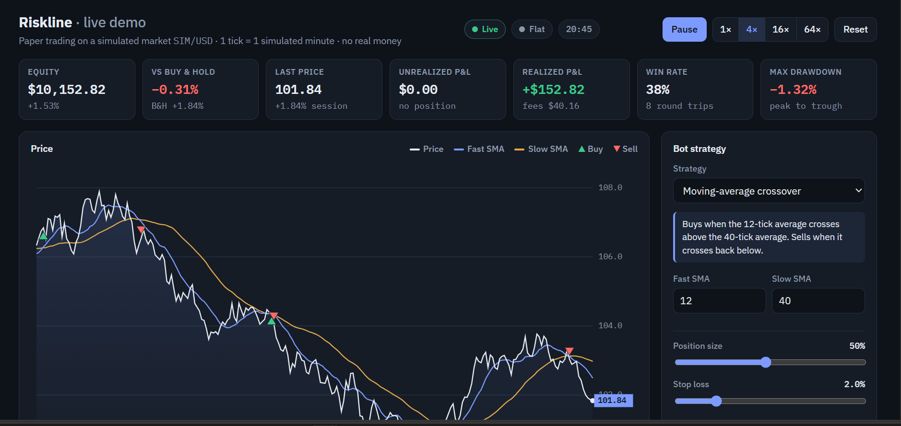
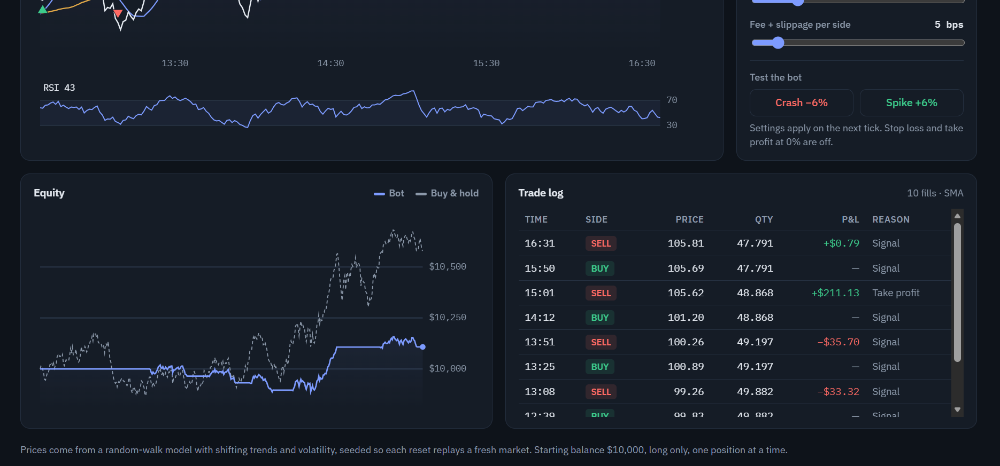
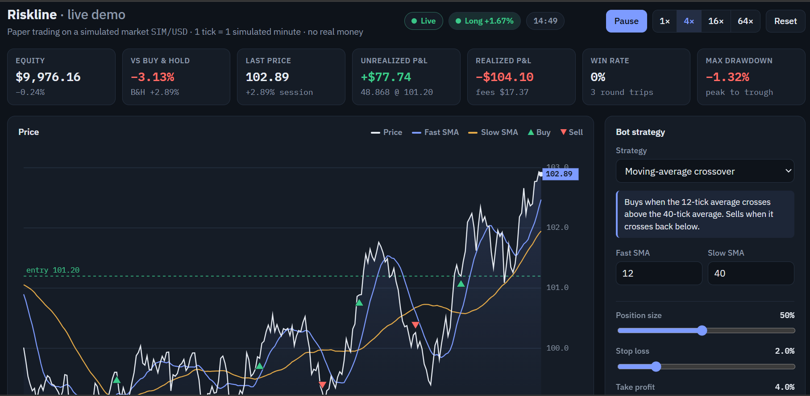

# Riskline

**Python paper-trading bot: live crypto and stock prices, three strategies, stop loss and daily loss limits. No real money.**

Riskline is a small Python trading bot that watches **real live prices** and trades with **paper money**. It uses the same three strategies and risk controls as the live demo page.

It can't trade real money. The local paper broker only simulates fills, and the Alpaca connector is hard-wired to Alpaca's *paper* endpoint.

# Riskline





## Demo

Riskline running on the simulated market (`--source sim`), sped up. Paper money only.

https://github.com/user-attachments/assets/1f62ded0-1451-44fb-9656-faf476cdffaa


## Requirements

- Python 3.10 or newer
- Nothing to install, because it only uses the standard library

## Quick start

```bash
cd riskline

# 1. Check everything works offline (simulated market, runs fast)
python -m unittest -v test_bot.py
python bot.py --source sim --poll 0.2

# 2. Backtest a strategy on real recent BTC history (no account needed)
python bot.py --source binance --symbol BTCUSDT --mode backtest --bars 3000

# 3. Run it live on real BTC prices with local paper money
python bot.py --source binance --symbol BTCUSDT
```

Press **Ctrl+C** to stop and see a session summary.

## Choosing a market

| Market | Command | Account needed |
|---|---|---|
| Crypto via Binance prices | `--source binance --symbol BTCUSDT` | No |
| Crypto via Coinbase prices | `--source coinbase --symbol BTC-USD` | No |
| US stocks via Alpaca | `--source alpaca --symbol AAPL` | Free Alpaca paper account |
| Crypto via Alpaca | `--source alpaca --symbol BTC/USD` | Free Alpaca paper account |
| Offline simulation | `--source sim` | No |

Crypto trades around the clock, so it's the easiest to watch. Stock bars only arrive while the US market is open, which is 14:30 to 21:00 UK time on weekdays.

If Binance is blocked where you are, use `--source coinbase`. For Binance US, set `BINANCE_BASE_URL=https://api.binance.us`.

### Using an Alpaca paper account

1. Sign up at alpaca.markets and switch to **Paper Trading**.
2. Generate API keys on the paper dashboard.
3. Set them in your terminal:
   ```bash
   export ALPACA_API_KEY=your_key_id        # Windows PowerShell: $env:ALPACA_API_KEY="..."
   export ALPACA_API_SECRET=your_secret
   ```
4. Choose where the orders go:
   - `--source alpaca` on its own takes Alpaca's prices and fills the orders locally.
   - Adding `--broker alpaca` sends real orders to your Alpaca paper account, so they show up in Alpaca's dashboard:
   ```bash
   python bot.py --source alpaca --symbol AAPL --broker alpaca
   ```

## Strategies

| `--strategy` | Rule | Settings |
|---|---|---|
| `sma` (default) | Buys when the fast moving average crosses above the slow one and sells when it crosses back below | `--fast 12 --slow 40` |
| `rsi` | Buys when the market is oversold and sells when it's overbought | `--rsi-buy 30 --rsi-sell 65` |
| `breakout` | Buys a new N-bar high and sells a new N/2-bar low | `--breakout-len 30` |

The bar length is set with `--interval`, which accepts `1m`, `5m`, `15m`, `1h`, `4h` or `1d`.

## Risk controls

| Flag | Default | What it does |
|---|---|---|
| `--size` | 0.5 | Fraction of equity put into each trade |
| `--stop` | 0.02 | Stop loss as a fraction (2%); `0` turns it off |
| `--take` | 0.04 | Take profit as a fraction (4%); `0` turns it off |
| `--max-daily-loss` | 0.05 | Closes the position and stops new trades for the rest of the day after a 5% drop |
| `--fee-bps`, `--slippage-bps` | 10, 5 | Trading costs per side used by the paper broker |
| `--cash` | 10000 | Starting paper balance |

The bot is long-only and holds one position at a time.

## How it works

- `--poll` sets how often the bot checks the price (default every 10 s).
- Stop losses and take profits are checked against the live price on every check.
- Strategy signals are only acted on when a bar **closes**, so a half-formed candle never triggers a trade.
- The paper position is saved in `state/`, so stopping and restarting carries on where you left off. Use `--fresh` to start over.
- Every fill is appended to `state/trades_<source>_<symbol>.csv`.

## Files

- `bot.py`: command line, the live loop and the backtester
- `strategies.py`: the three strategies
- `feeds.py`: price sources (simulated, Binance, Coinbase, Alpaca)
- `brokers.py`: the local paper broker and the Alpaca paper broker
- `test_bot.py`: offline tests

## Adding your own strategy

In `strategies.py`, write a class with three things:

- a `warmup` property giving how many bars it needs
- a `describe()` method returning a one-line summary
- a `signal(closes)` method returning `1` (buy), `-1` (sell) or `0` (do nothing)

Then add it to `make_strategy` and to the `--strategy` choices in `bot.py`.

## A word of caution

Backtests on the simulated market mean nothing, because its random trends happen to suit trend-following. Real markets are much harder. Fees, slippage and over-tuning settings to past data eat most simple strategies alive. Paper-trade for weeks, compare against just holding, and treat this as a learning tool, not financial advice.
